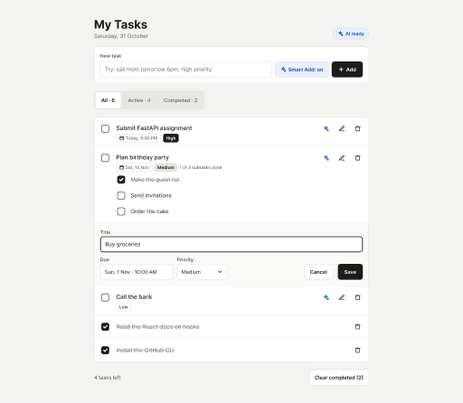

# AI Todo App

A todo app with AI helpers, built to learn **Python + FastAPI**, **React** and **AI integration** with Claude.
It was built in ten small, reviewed milestones: one pull request each, with focused commits.

**Live demo: https://anjanichilumula.github.io/ai-todo-app/**



## Features

- **Tasks:** add, tick off, edit inline (title, due date, priority) and delete
- **Subtasks:** shown under their parent with "N of M subtasks done"
- **Filters:** All / Active / Completed with counts, "N tasks left", and Clear completed
- **Due dates** in your local time ("Today, 5:00 PM", "Tomorrow"), highlighted when overdue
- **Smart Add (AI):** type *"call mom tomorrow 6pm, high priority"*. Claude fills in the title, due date and priority, and you confirm or edit before anything is saved.
- **Break it down (AI):** get 3–6 suggested subtasks for any task and tick the ones you want
- **Phones:** task actions move into a bottom sheet
- **Accessible:** real form controls, labelled buttons, visible focus, focus returned after dialogs, 44px touch targets

## Live demo vs. full app

| | Live demo (GitHub Pages) | Full app (your computer) |
|---|---|---|
| Tasks saved in | Your browser (`localStorage`) | SQLite, via the FastAPI backend |
| AI features | Off: GitHub Pages can't run Python, and an API key must never be in a public site | On, once you add your Anthropic API key |

Every merge to `main` redeploys the demo (`.github/workflows/deploy-pages.yml`).

## Tech stack

| Part | Tools |
|---|---|
| Backend | Python 3.11, FastAPI, SQLModel + SQLite, pydantic-settings |
| AI | Anthropic Python SDK, Claude Opus 5.5, structured outputs |
| Frontend | React 19, Vite 6, plain CSS |
| Tests | pytest (39 tests), Vitest + Testing Library (51 tests) |
| Quality | ruff, ESLint, GitHub Actions CI on every pull request |

## Project structure

```
backend/
  app/
    main.py            FastAPI app, CORS, routers, /api/health
    config.py          settings from environment / backend/.env
    db.py, models.py   SQLite engine and the Todo model + schemas
    routers/todos.py   CRUD endpoints
    routers/ai.py      /api/ai/parse and /api/ai/breakdown
    ai/client.py       every Claude API call lives here
  tests/
frontend/
  src/
    api/client.js      fetch wrapper for the backend
    storage/           apiStore (backend) and localStore (browser, used by the demo)
    hooks/useTodos.js  task state + actions
    components/        form, list, items, Smart Add preview, Break it down dialog, ...
docs/
  PLAN.md              the approved project plan
  wireframes/          the approved wireframes
```

## Run the backend

Requires Python 3.11+.

```bash
cd backend
python -m venv .venv
.venv\Scripts\activate          # Windows (macOS/Linux: source .venv/bin/activate)
pip install -r requirements-dev.txt
copy .env.example .env          # macOS/Linux: cp .env.example .env
uvicorn app.main:app --reload
```

Open http://localhost:8000/docs for the interactive API docs. Tasks are stored in `backend/todos.db`.

### Database migrations

The schema is managed by [Alembic](https://alembic.sqlalchemy.org/) (`backend/migrations/`). The backend upgrades
the database automatically when it starts, so there is nothing to run by hand. A database from v1 is recognised and
upgraded in place, keeping your tasks.

When you change a model in `app/models.py`, create a migration for it (from `backend/`):

```bash
alembic revision --autogenerate -m "describe the change"
```

Review the generated file in `migrations/versions/`, then restart the backend (or run `alembic upgrade head`). A test
fails if a model and the migrations ever disagree.

### Turn on the AI features

1. Create an API key at https://console.anthropic.com/ (API usage is billed by Anthropic).
2. In `backend/.env`, set `ANTHROPIC_API_KEY=...`. The file is git-ignored, so the key never reaches GitHub.
3. Restart the backend. `/api/health` now reports `"ai_enabled": true`, and the app shows "AI ready".

The AI uses **Claude Opus 5.5** (change it with `ANTHROPIC_MODEL`) with structured outputs, so answers always come back
in the expected fields. The AI only *suggests*: nothing is saved until you confirm.

### API

| Method | Path | What it does |
|---|---|---|
| GET | `/api/health` | `{"status": "ok", "ai_enabled": true}` |
| GET | `/api/todos?status=all\|active\|completed` | List tasks and subtasks |
| POST | `/api/todos` | Create a task; add `"parent_id"` for a subtask |
| PATCH | `/api/todos/{id}` | Change some fields, e.g. `{"completed": true}` |
| DELETE | `/api/todos/{id}` | Delete a task and its subtasks |
| DELETE | `/api/todos?completed=true` | Clear completed tasks |
| POST | `/api/ai/parse` | `{"text": "...", "timezone": "Asia/Kolkata"}` → suggested `title`, `due_at`, `priority`, `notes` |
| POST | `/api/ai/breakdown` | `{"todo_id": 1}` → `{"subtasks": [...]}` |

Dates are returned in UTC (ending in `Z`). AI endpoints return `503` with setup steps when no key is set.

### Accounts (v2, in progress)

| Method | Path | What it does |
|---|---|---|
| POST | `/api/auth/signup` | `{"name", "email", "password"}`: creates the account and signs in |
| POST | `/api/auth/login` | `{"email", "password"}`: signs in |
| POST | `/api/auth/logout` | Signs this browser out |
| GET | `/api/auth/me` | The signed-in user, or `401` |
| GET | `/api/auth/config` | Which sign-in methods are on: `{"password": true, "google": false}` |
| GET | `/api/auth/google/start` | Redirects to Google (when configured) |
| GET | `/api/auth/google/callback` | Google sends the browser back here; signs in and redirects to the app |
| PATCH | `/api/account` | `{"name"}`: rename yourself |
| POST | `/api/account/password` | `{"current_password", "new_password"}`: signs out your other devices |
| GET | `/api/account/sessions` | Devices you're signed in on ("Chrome on Windows"), this one marked `current` |
| DELETE | `/api/account/sessions/{id}` | Sign out one device |
| DELETE | `/api/account/sessions?others=true` | Sign out everywhere else |
| GET | `/api/admin/users` | Admins only: accounts with role, status, task count, last activity |
| PATCH | `/api/admin/users/{id}` | Admins only: `{"is_active"}` and/or `{"role"}`; you can't change your own account |

How sign-in is protected:
- **Passwords** are hashed with Argon2 and never stored or returned
- **Sessions** are server-side: the browser holds a random token in an `HttpOnly`, `SameSite=Lax` cookie, and the
  database keeps only its SHA-256 hash. They end after 14 idle days, or 30 days at most.
- **Guessing** is slowed down: 5 wrong passwords for an email lock it for 15 minutes, and a wrong email gets the same
  answer as a wrong password
- **Cross-site requests**: any `POST`/`PATCH`/`DELETE` from another website's origin is refused (`403`)
- Set `COOKIE_SECURE=true` in `backend/.env` when the app is served over HTTPS

### Sign in with Google (optional)

1. In [Google Cloud Console](https://console.cloud.google.com/apis/credentials), create an **OAuth client ID** of
   type **Web application**.
2. Add the **authorized redirect URI** `http://localhost:5173/api/auth/google/callback`. It goes through the Vite
   proxy, so the session cookie is set for the app's own address.
3. Put the client id and secret in `backend/.env` as `GOOGLE_CLIENT_ID` and `GOOGLE_CLIENT_SECRET`, and set
   `SECRET_KEY` to a long random string. Restart the backend.

`GET /api/auth/config` then reports `"google": true` and the sign-in page shows the Google button. Signing in with
Google using the email of an existing account links the two (Google must confirm the email is verified). Accounts
created through Google have no password until you set one in Settings.

Every task belongs to the account that created it. All `/api/todos` and `/api/ai/*` endpoints need a session
(`401` without one), and another user's task id answers `404` exactly like a missing one.

### Admin commands

Run from `backend/` with the virtualenv active:

```bash
python -m app.cli make-admin you@example.com
```

gives an account the admin role (this is how the first admin is created).

```bash
python -m app.cli claim-tasks you@example.com
```

moves tasks that have no owner, i.e. tasks you made in v1 before accounts existed, into that account. Sign up in the
app first, then run it once.

## Run the frontend

Requires Node.js 20+ (22 LTS recommended). With the backend running, in a second terminal:

```bash
cd frontend
npm install
npm run dev              # http://localhost:5173
```

`npm run preview:demo` builds and serves the GitHub Pages demo locally at http://localhost:4173/ai-todo-app/.

## Checks

```bash
cd backend
ruff check . && ruff format --check . && pytest

cd frontend
npm run lint && npm test && npm run build
```

The same checks run on every pull request (`.github/workflows/ci.yml`). Tests never call the real Claude API: the
backend uses a fake AI plus the real SDK against a mock HTTP transport, and the frontend mocks the AI calls.

## How it was built

| Milestone | What | PR |
|---|---|---|
| M0 | Project plan and wireframes | [#1](https://github.com/AnjaniChilumula/ai-todo-app/pull/1) |
| M1 | FastAPI skeleton, settings, tests, CI | [#2](https://github.com/AnjaniChilumula/ai-todo-app/pull/2) |
| M2 | Todos API with SQLite | [#3](https://github.com/AnjaniChilumula/ai-todo-app/pull/3) |
| M3 | React skeleton, tests, frontend CI | [#4](https://github.com/AnjaniChilumula/ai-todo-app/pull/4) |
| M4 | Task list: add, complete, delete, subtasks | [#5](https://github.com/AnjaniChilumula/ai-todo-app/pull/5) |
| M5 | Editing, due dates, priority, filters | [#6](https://github.com/AnjaniChilumula/ai-todo-app/pull/6) |
| M6 | Live demo on GitHub Pages | [#7](https://github.com/AnjaniChilumula/ai-todo-app/pull/7) |
| M7 | AI endpoints with Claude | [#8](https://github.com/AnjaniChilumula/ai-todo-app/pull/8) |
| M8 | Smart Add and Break it down in the UI | [#9](https://github.com/AnjaniChilumula/ai-todo-app/pull/9) |
| M9 | Phone layout, focus handling, docs | [#10](https://github.com/AnjaniChilumula/ai-todo-app/pull/10) |

See [docs/PLAN.md](docs/PLAN.md) for the plan and [docs/wireframes](docs/wireframes/README.md) for the designs.

### Next: v2

Accounts (email + password and Google), server-side sessions, per-user tasks with an admin role, and UI work: dark
mode, search and sort, undo, and date groups. See the [v2 plan](docs/PLAN-v2.md) and
[v2 wireframes](docs/wireframes/v2/README.md) (milestones M10–M20).

## License

[MIT](LICENSE)
