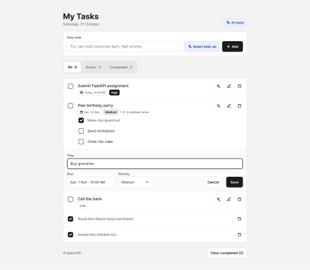
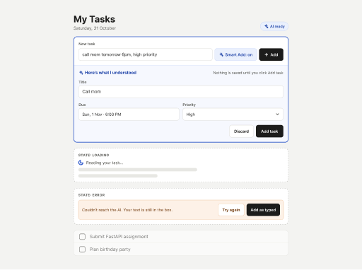
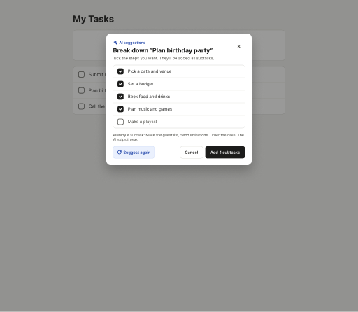
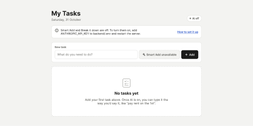
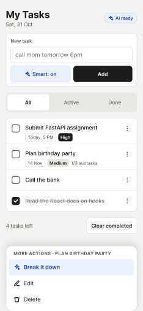

# Wireframes

Low-fidelity wireframes, reviewed and approved before any code was written.
The editable source is a Figma file in the reviewer's drafts (private): *AI Todo App — Wireframes*, page "Wireframes v1".
The images below are small previews exported from it.

Blue marks AI features. Everything AI suggests needs a click before it is saved.

## 1. Task list

Tasks with due date and priority chips, a task with subtasks, one row in inline edit mode, and completed tasks.

## 2. Smart Add preview

The AI's reading of a typed sentence, shown as editable fields to confirm. Includes the loading and error states.

## 3. Break it down

Suggested subtasks to tick before adding. Existing subtasks are skipped.

## 4. First run, AI not configured

Empty state, plus the banner shown when no API key is set. This is also what the GitHub Pages demo shows.

## 5. Mobile (390 px)

Compact rows. Task actions move into a bottom sheet behind a "more" button.

