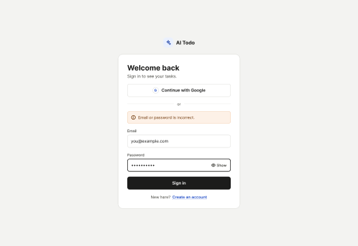
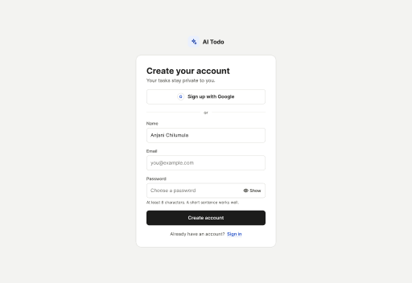
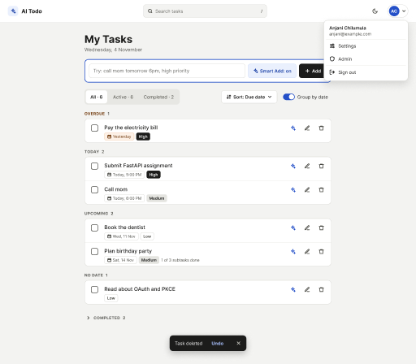
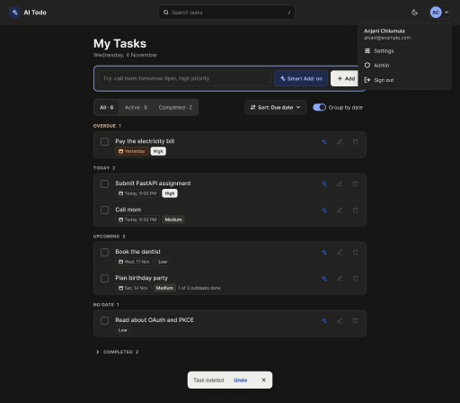
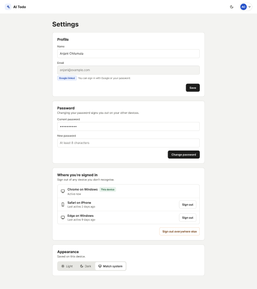
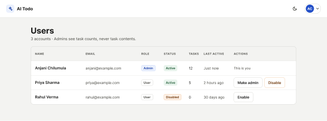

# Wireframes v2: accounts, sessions, admin and UI

Low-fidelity wireframes for the [v2 plan](../../PLAN-v2.md). The editable source is page "Wireframes v2" in the
reviewer's Figma file *AI Todo App — Wireframes* (private); these are small previews exported from it.

## 1. Sign in

Email and password or Google, with the error shown for a wrong email or password (the same message either way, so it
doesn't reveal which emails have accounts).

## 2. Create account

Name, email and password (8+ characters), or sign up with Google.

## 3. Tasks with the app shell

Top bar with search, theme switch and the user menu (open here: Settings, Admin, Sign out). Sort and "Group by date"
controls, tasks grouped into Overdue · Today · Upcoming · No date, completed tasks folded, and the undo toast after a
delete.

## 4. The same screen in dark mode

## 5. Settings

Profile (email is read-only; shows when Google is linked), password change, the devices you're signed in on with
"Sign out" per device and "Sign out everywhere else", and the theme switch.

## 6. Admin

Accounts with role, status, task count and last activity. Admins can make or remove admins and disable or enable
accounts, but can't change their own account and never see task contents.

